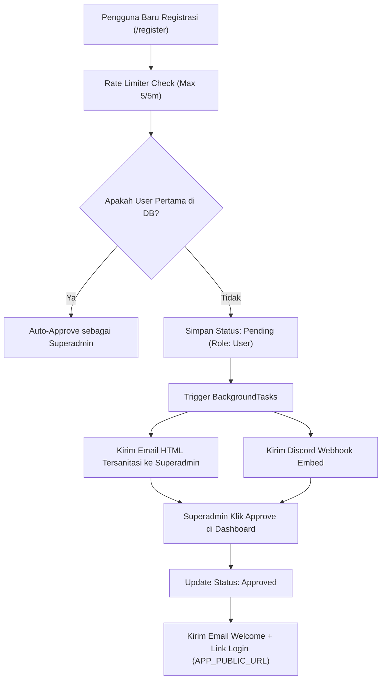
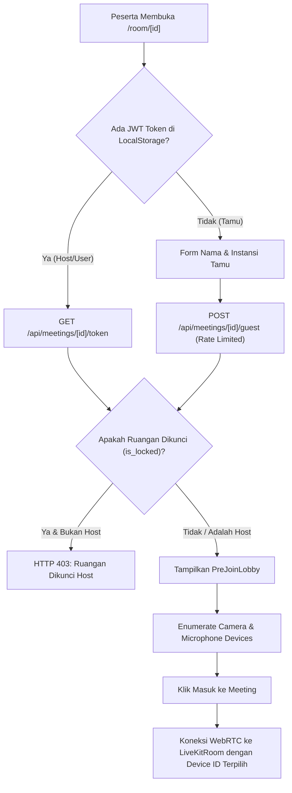

# Architecture & Flow Diagram (AFD) — Minizoom v1.6.0

Dokumen ini memvisualisasikan alur arsitektur, autentikasi, moderasi rapat, dan sinkronisasi data *real-time* pada **Minizoom**.

---

## 1. Alur Pendaftaran & Persetujuan Pengguna (User Lifecycle Flow)

---

## 2. Alur Masuk Ruangan & Pre-Join Lobby (Room Join Flow)

---

## 3. Alur Sinkronisasi Kolaborasi Real-Time (DataChannel Flow)

| Paket DataChannel (`type`) | Pengirim | Penerima | Deskripsi |
| :--- | :--- | :--- | :--- |
| `reaction` | Semua Peserta | Semua Peserta | Menampilkan animasi floating emoji (`ReactionOverlay.tsx`). |
| `wb_draw` | Semua Peserta | Semua Peserta | Menggambar segmen garis ternormalisasi `(0..1)` di `WhiteboardModal.tsx`. |
| `wb_clear` | Host / Peserta (Konfirmasi) | Semua Peserta | Membersihkan kanvas dan riwayat goresan Whiteboard. |
| `wb_sync` | Host | Peserta Baru | Mengirim hingga 500 segmen goresan terakhir saat event `ParticipantConnected`. |
| `poll_new` | Host | Semua Peserta | Mempublikasikan pertanyaan polling baru ke tab Polls. |
| `poll_vote` | Semua Peserta | Semua Peserta | Memperbarui suara peserta pada opsi polling secara langsung. |
| `notes_sync` | Semua Peserta | Semua Peserta | Sinkronisasi *debounced* (500ms) catatan rapat bersama. |
| `state_sync` | Host | Peserta Baru | Mengirim daftar Polls aktif dan isi Shared Notes kepada peserta yang baru masuk. |
