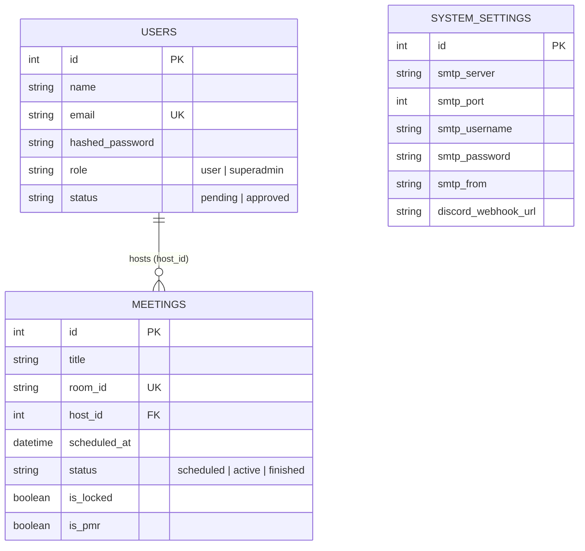

# Database Design Document (DBD) — Minizoom v1.6.0

Dokumen ini menjelaskan rancangan skema database, relasi antar tabel, serta konfigurasi konkurensi pada **Minizoom**.

---

## 1. Entity-Relationship Diagram (ERD)

---

## 2. Strategi Konkurensi & Persistensi (`backend/database.py`)

### Mode 1: SQLite WAL (Default Self-Hosted)
- Lokasi file default di dalam container: `/app/data/minizoom.db` (dipetakan ke Docker volume `minizoom_data`).
- Menggunakan `StaticPool` dengan `check_same_thread=False` dan `timeout=30`.
- Mengaktifkan pragma performa tinggi saat koneksi dibuat:
  - `PRAGMA journal_mode=WAL` (pembacaan dan penulisan berjalan paralel tanpa saling memblokir).
  - `PRAGMA synchronous=NORMAL`
  - `PRAGMA cache_size=-64000` (64MB RAM cache).
  - `PRAGMA temp_store=MEMORY`

### Mode 2: PostgreSQL / MySQL (Multi-Worker Production)
- Aktif secara otomatis ketika variabel environment `DATABASE_URL` diubah ke URI non-SQLite (contoh: `postgresql://user:pass@db:5432/minizoom`).
- Menggunakan connection pool standar SQLAlchemy (`pool_pre_ping=True`, `pool_size=10`, `max_overflow=20`).

---

## 3. Migrasi Skema Otomatis & Cascading Cleanup
- Fungsi `run_migrations()` di `database.py` memeriksa keberadaan kolom baru (`is_locked`, `is_pmr`) pada tabel `meetings` saat startup dan menambahkannya secara otomatis (`ALTER TABLE`) tanpa menghapus data lama.
- Saat Superadmin menghapus akun pengguna (`DELETE /api/admin/users/{user_id}`), seluruh rapat (`meetings`) yang dimiliki oleh pengguna tersebut dihapus terlebih dahulu secara transaksional.
