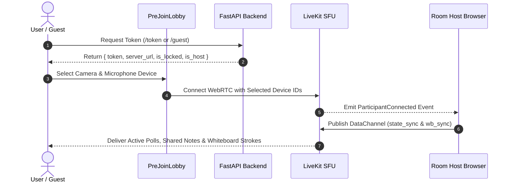

# System Architecture & Technical Design

This document details the architectural design, modular component structure, communication protocols, and data flow of **Minizoom v1.6.0**.

---

## 1. High-Level System Architecture

```
                                 [ Users / Browsers ]
                                          │
                        (HTTPS / WSS Port 443 - Public Internet)
                                          │
                                          ▼
                                ┌───────────────────┐
                                │   Reverse Proxy   │
                                │   (Nginx / Caddy) │
                                └─────────┬─────────┘
                                          │
                     ┌────────────────────┴────────────────────┐
                     │                                         │
        (HTTP / Internal Port 3000)               (HTTP / Internal Port 8000)
                     ▼                                         ▼
           ┌──────────────────┐                      ┌──────────────────┐
           │ Next.js Frontend │                      │ FastAPI Backend  │
           │  (App Router)    │                      │  (ASGI / uvloop) │
           └─────────┬────────┘                      └─────────┬────────┘
                     │                                         │
                     │ (MediaStream WebRTC & Data Channel)     │ (JWT Token Generation & API)
                     ▼                                         ▼
           ┌──────────────────┐                      ┌──────────────────┐
           │   LiveKit SFU    │                      │   Database       │
           │  (Cloud / Host)  │                      │ (SQLite / PG)    │
           └──────────────────┘                      └──────────────────┘
```

---

## 2. Component Breakdown

### A. Frontend Layer (`Next.js + React + LiveKit Components`)
- **Render Engine**: Next.js Standalone Runner compiled into a lightweight Alpine Docker image (~100MB).
- **Modular Room Architecture (`frontend/src/components/room/`)**:
  - `PreJoinLobby.tsx`: Live camera/microphone hardware enumeration (`enumerateDevices()`), device selector dropdowns, mirrored video preview, and Web Audio API microphone volume meter.
  - `RoomHeader.tsx`: Room status indicator, 1-click invite link copier, Whiteboard launcher, Adaptive Low-Data Mode toggle, and real-time participant counter.
  - `WhiteboardModal.tsx`: Collaborative HTML5 Canvas supporting mouse and mobile touch events (`touch-none`), persistent stroke history across resize/re-open, and automatic `wb_sync` for late joiners.
  - `ParticipantSidebar.tsx`: Multi-tab collaboration drawer (Participants & Host Moderation, Live Chat with unread badges, Live Polls, Shared Meeting Notes with `.txt` export, and Client-Side `.webm` Screen/Audio Recorder).
  - `ReactionOverlay.tsx`: Floating emoji reactions (`👍`, `❤️`, `👏`, `😂`, `🎉`, `🔥`, `🚀`) over WebRTC DataChannels.
  - `SoundSynthesizer.ts`: Pure Web Audio API oscillator synthesizer for join, leave, and chat notification chimes.

### B. Backend API Layer (`FastAPI + Python + Uvicorn`)
- **Event Loop**: `uvloop` for high-concurrency asynchronous request processing.
- **Rate Limiter**: Built-in IP-based sliding window rate limiter protecting `/api/login`, `/api/register`, and `/api/meetings/{room_id}/guest`.
- **Token Handshake Engine**: LiveKit Access Token signing with `api.VideoGrants` validating host permissions (`room_admin`), identity uniqueness, and room lock status.
- **Server-Side Moderation**: LiveKit Server SDK invoking participant kick, track mute, mute-all, and video disable operations directly on the SFU.
- **Background Notification Services**: Asynchronous dispatch for sanitized HTML SMTP emails (`email_service.py`) and Discord Webhooks (`discord_service.py`).

### C. Media & SFU Layer (`LiveKit WebRTC SFU`)
- **Topology**: Selective Forwarding Unit (SFU). Each publisher uploads a single uplink stream, and the SFU selectively forwards streams to subscribers without server-side transcoding.
- **Audio Codec**: Opus (adaptive bitrate 24–32 kbps with Packet Loss Concealment & RED/FEC).
- **Video Codec**: VP8 / H.264 with Dynacast and Adaptive Simulcast layers (switches between 720p HD and 360p Low-Data Mode).

### D. Data Persistence (`SQLite WAL Mode / PostgreSQL`)
- **Dual-Engine Support (`backend/database.py`)**:
  - **SQLite Default**: Configured with `PRAGMA journal_mode=WAL` (Write-Ahead Logging), `PRAGMA synchronous=NORMAL`, and `StaticPool` connection sharing on `/app/data/minizoom.db`.
  - **PostgreSQL Ready**: Automatically switches to standard connection pooling (`pool_pre_ping=True`, `pool_size=10`, `max_overflow=20`) when `DATABASE_URL` points to PostgreSQL.

---

## 3. Communication & Data Flow Sequence

### Room Join & Late-Joiner State Sync:

